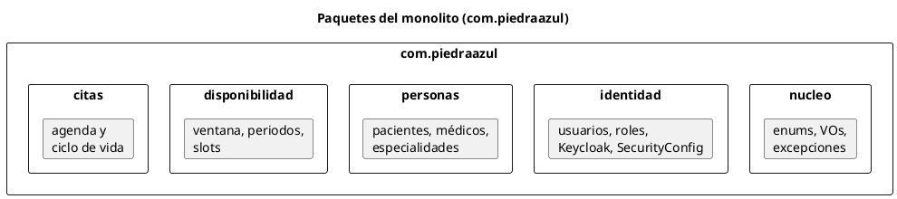
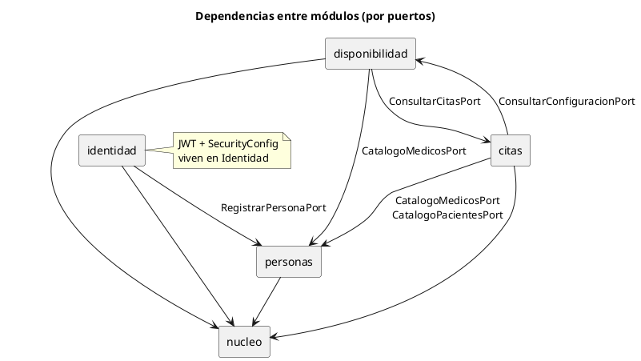

# Arquitectura

Monolito modular. Entre módulos se habla por puertos: el que necesita algo
declara la interfaz y el otro la implementa con una fachada.

Cada módulo trae su `infraestructura` (REST, JPA, DTO). La seguridad no es un
paquete suelto: vive en Identidad.

## Paquetes

## Dependencias

Citas y Disponibilidad se miran entre sí solo por puertos (fachadas), no por
repositorios ajenos. Así no se arma un ciclo raro de beans.

## Diagramas de clases

- [Núcleo](diagramas/01-nucleo.md)
- [Identidad](diagramas/02-identidad.md)
- [Personas](diagramas/03-personas.md)
- [Disponibilidad](diagramas/04-disponibilidad.md)
- [Citas](diagramas/05-citas.md)

Índice: [Diagramas](diagramas/index.md).
