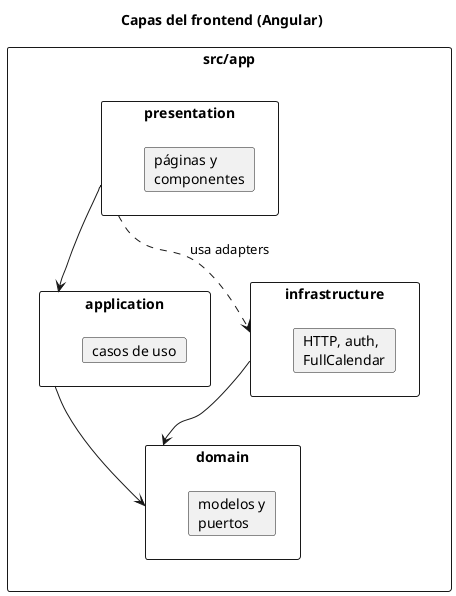

# Frontend

SPA Angular 19. Consume la API y pinta las pantallas de los RF.

## Stack

| Tecnología | Uso |
|---|---|
| Angular 19 (standalone, signals) | UI |
| Hexagonal | domain → use cases → HTTP |
| Reactive Forms | validación cliente |
| FullCalendar 7 | calendario |
| Atomic Design | `ui-*` / `pz-*` |

## Capas

Los puertos se cablean en `app.config.ts`.

## Rutas

| Ruta | Uso |
|---|---|
| `/` | landing |
| `/login` / `/registro` | auth |
| `/panel/*` | panel por rol |
| `/agenda` | citas del día + CSV |
| `/agendar` | reservar |
| `/configuracion` | ventana / horarios |
| `/calendario` | FullCalendar |
| `/historial` | consultas atendidas |
| `/citas-por-cedula` | RF5 |
| `/personas` | catálogo |

## Auth en UI

Token en `AuthSessionStore` + interceptor. Menús según `permisos.ts`
(alineado a `SecurityConfig`). El médico queda amarrado a su `personaId`.

Login: `POST /api/auth/login` (el backend habla con Keycloak).
