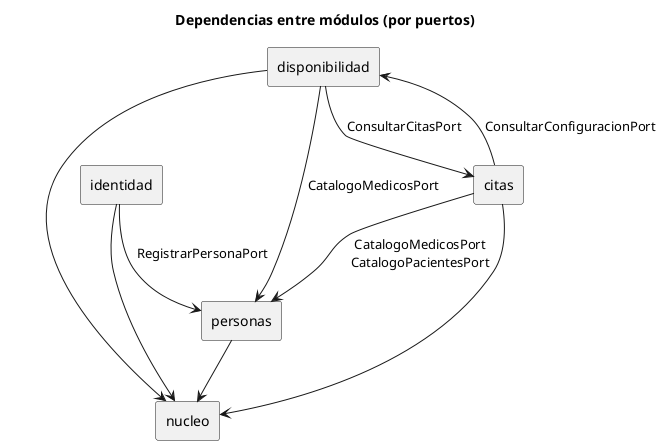

# Módulos

| Módulo | Paquete | Estado |
|---|---|---|
| Núcleo | `nucleo` | ok |
| Identidad | `identidad` | ok (Keycloak / RNF1) |
| Personas | `personas` | ok |
| Disponibilidad | `disponibilidad` | ok |
| Citas | `citas` | ok |

- [Núcleo](nucleo.md)
- [Identidad](identidad.md)
- [Personas](personas.md)
- [Disponibilidad](disponibilidad.md)
- [Citas](citas.md)
- [Seguridad](seguridad.md)

## Dependencias

Un módulo no importa el repo ni la entidad de otro. Solo el puerto:

| Puerto | Lo implementa | Lo consume |
|---|---|---|
| `CatalogoMedicosPort` | Personas | Disponibilidad, Citas |
| `CatalogoPacientesPort` | Personas | Citas |
| `RegistrarPersonaPort` | Personas | Identidad |
| `ConsultarConfiguracionPort` | Disponibilidad | Citas |
| `ConsultarCitasPort` | Citas | Disponibilidad |

## Seed

Clase `SeedDatosDemo` (bootstrap, no es módulo de negocio).

Si `APP_SEED_ENABLED=true` y no hay `admin`, siembra especialidades, usuarios
demo (`demo1234`), horarios y citas. Para regenerar: `docker compose down -v`
y volver a levantar.
