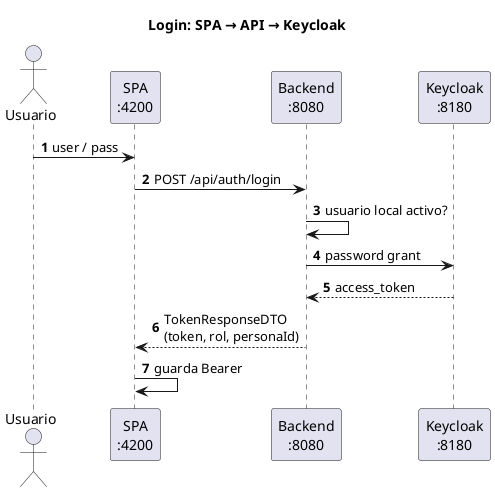

# Seguridad

Esta parte es del **RNF1**: autenticación y autorización con JWT de Keycloak.

Antes el backend firmaba el token con JJWT. Ahora Keycloak emite el JWT y el
backend solo valida (OAuth2 Resource Server) y arma el `UsuarioAutenticado`
(rol + `personaId`). El dominio de permisos por API **no se tiró**: sigue en
`SecurityConfig`. Lo de “solo mi agenda / solo mi paciente” va en los
controllers con `SesionActual`.

## Cómo entrar a Keycloak (consola admin)

1. Con el compose arriba, abre **http://localhost:8180**
2. Clic en **Administration Console**
3. Usuario: `admin` — Password: `admin`  
   (es el admin del contenedor / realm `master`, no el usuario `admin` de la app)
4. Arriba a la izquierda, cambia el realm a **`piedraazul`**
5. Ahí ves Users, Realm roles, Clients (`piedraazul-backend`)

Los usuarios de la app (`agendador`, `ana.medico`, etc.) viven en ese realm.
Pass de demo: `demo1234`.

Si Keycloak no abre, revisa que el contenedor esté healthy:
`docker compose ps`.

## Login de la aplicación

El front no habla con Keycloak a mano. Flujo:



En el navegador: http://localhost:4200/login con un usuario demo.

## Config

```properties
app.security.provider=keycloak
app.security.keycloak.server-url=http://keycloak:8080
app.security.keycloak.issuer-uri=http://localhost:8180/realms/piedraazul
app.security.keycloak.jwk-set-uri=http://keycloak:8080/realms/piedraazul/protocol/openid-connect/certs
app.security.keycloak.realm=piedraazul
app.security.keycloak.client-id=piedraazul-backend
```

Sin contenedor (tests): `app.security.provider=local` (Nimbus, mismos claims).

## Importante

- El `iss` del token tiene que ser `http://localhost:8180/realms/piedraazul`.
  Si sale mal, las APIs dan 401 aunque el login “parezca” ok.
- Admin de Keycloak (`admin`/`admin`) ≠ usuario app `admin` (`demo1234`).

## Rutas públicas

| Método | Ruta |
|---|---|
| `POST` | `/api/auth/login` |
| `POST` | `/api/auth/registro-paciente` |
| `GET` | `/actuator/health` |

## Token en Postman

Por la API:

```http
POST http://localhost:8080/api/auth/login
Content-Type: application/json

{ "username": "agendador", "password": "demo1234" }
```

Directo a Keycloak (`x-www-form-urlencoded`):

`POST http://localhost:8180/realms/piedraazul/protocol/openid-connect/token`

campos: `grant_type=password`, `client_id=piedraazul-backend`, `username`, `password`.

Después: `Authorization: Bearer …`.

## Usuarios demo (app)

Pass: `demo1234`

| Username | Rol |
|---|---|
| `admin` | ADMINISTRADOR |
| `agendador` | AGENDADOR |
| `ana.medico` / `carlos.medico` | MEDICO |
| `juan.paciente` / `maria.paciente` | PACIENTE |

## Matriz (resumen)

| Área | ADMIN | AGENDADOR | MEDICO | PACIENTE |
|---|:---:|:---:|:---:|:---:|
| CRUD usuarios | ✔ | — | — | — |
| Especialidades / médicos (escritura) | ✔ | — | — | — |
| Paciente walk-in | ✔ | ✔ | ✔ | — |
| Por cédula (RF5) | — | ✔ | ✔ | — |
| Ventana agendamiento | ✔ | — | — | — |
| Periodos | ✔ | ✔ | ✔\* | — |
| Slots | ✔ | ✔ | ✔ | ✔ |
| Agendar / cancelar / reagendar | ✔ | ✔ | ✔ | ✔\* |
| Atender | — | — | ✔\* | — |
| Agenda del día | API | ✔ | ✔\* | — |
| CSV (RF4) | — | ✔ | ✔\* | — |

\* = solo su `personaId`. En la UI el admin no ve Agenda ni “Por cédula”.
